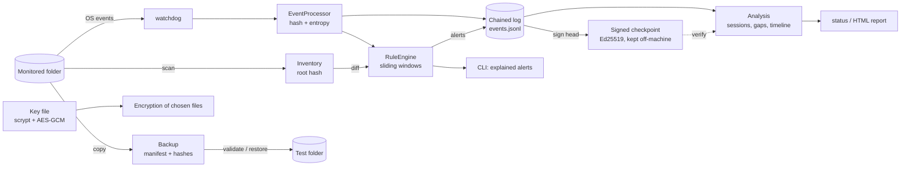

# Bastion

**Defensive ransomware-signal detection and file integrity protection for small businesses.**
An open source, educational portfolio project written in Python.


> **Notice:** Bastion is a **defensive** tool. It contains no attack, propagation, persistence, evasion or bulk-encryption capability. Its alerts are **signals for analysis**, never a verdict that something is malicious. It does not replace antivirus/EDR or a backup policy.

---

## Problem

Small businesses often have little visibility into what happens to their files. When a ransomware incident strikes, many only notice after dozens of documents have already been changed, and they find out too late that their backups are stale, were hit too, or have never been tested.

## Approach

Bastion tackles the problem on five fronts, all with simple-to-operate tools:

| Front | What it does |
|---|---|
| **Visibility** | Monitors a folder, records file creation, modification, rename and deletion (with SHA-256 and entropy) and keeps a verifiable inventory. |
| **Alerting** | Ten configurable rules (bulk modification/rename/deletion, entropy spikes, **lost file headers**, **one new extension on many files**, **the same note dropped in many folders**, canary files…) produce alerts that explain *what was seen*, *why it might be legitimate* and *what to check*. |
| **Evidence** | A hash-chained log, **Ed25519-signed checkpoints** that expose even a fully rebuilt chain, a `status` health check, and a self-contained **HTML incident report**. |
| **Recovery** | Demo backup with manifest and hashes, integrity validation and a restore that **never overwrites without confirmation**. |
| **Protection** | Authenticated encryption (AES-256-GCM) of explicitly chosen files only, with documented key management. |

To practice without risk there is a **safe simulation** that uses fictional files.

### Design highlights

- **Hash-chained log.** Every record includes the hash of the previous one; editing, removing or reordering lines breaks the chain (`bastion log verify`). With the chain "head" written down off the machine, even truncation is detectable.
- **Entropy with a *delta*.** The signal is not "a file with high entropy" (a `.zip` always has it), but "this file **went from text to near-random data** after a modification".
- **Signed checkpoints.** A hash chain alone cannot stop someone with write access from editing a record and recomputing every hash that follows. A checkpoint (`bastion log checkpoint`) signs "the log had N records and head H" with an Ed25519 key you keep elsewhere; verification needs only the public key and catches rewritten history, truncation and swapped logs, **even when the rewritten chain is self-consistent** (there is a test for exactly that attack).
- **Header loss, not only entropy.** `.docx`, `.xlsx`, `.zip`, `.pdf` and `.jpg` files are born with high entropy, so an entropy *jump* never shows when their content is replaced. `header_lost` notices that a file which used to start with a known format header (PDF, ZIP/Office, PNG, JPEG…) no longer does.
- **Coverage gaps.** The report lists every period in which no monitor was running, and flags sessions that ended without a clean stop (a crash, a kill, a power cut, or an attacker stopping the process).
- **Canary files.** No legitimate user has a reason to touch them; any change raises an immediate alert.
- **Signal correlation.** Independent rules coinciding in time raise the analysis priority without claiming a cause.
- **State outside the monitored folder.** Inventory and log live elsewhere; the program **refuses** setups where the evidence would sit inside the monitored area.
- **External anchors.** The inventory root hash, the log head and the backup manifest digest are printed so you can store them *off* the machine.
- **Per-file encryption keys.** Random data key protected by a passphrase (scrypt), with a per-file subkey (HKDF) and an authenticated header.
- **Sandboxed simulation.** It only operates on files it created itself and re-checks the path on every operation.

---

## Architecture



Each module has a single responsibility:

| Module (`src/bastion/`) | Responsibility |
|---|---|
| `cli.py` | Commands, messages and exit codes. No business logic. |
| `config.py` | Configurable rules, strict validation, state location. |
| `paths.py` | Path validation, anti path-traversal, "one folder must not be inside the other". |
| `fsutil.py` | Atomic writes/copies and overwrite confirmation. |
| `fingerprint.py` | SHA-256, Shannon entropy and content type in a single read. |
| `filetypes.py` | Small, conservative table of file signatures (magic bytes) used by `header_lost`. |
| `events.py` | `Event` and `Alert` (with legitimate causes and a suggested action). |
| `inventory.py` | Scanning, root hash, comparison (including renames) and conversion to events. |
| `eventlog.py` | Chained JSONL log, verification and queries. |
| `rules.py` | Deterministic rule engine (uses the event timestamp, not the wall clock). |
| `canary.py` | Canary files. |
| `monitor.py` | `EventProcessor` (testable without watchdog) and `Monitor` (observer). |
| `crypto.py` | AES-256-GCM, scrypt, HKDF, passphrase change and key rotation. Also the passphrase-sealing primitive reused for signing keys. |
| `signing.py` | Ed25519 key pairs and signed log checkpoints. |
| `report.py` | Reads a state folder (never modifies it): analysis, coverage gaps, health findings, HTML/Markdown/JSON reports. |
| `backup.py` | Backup with manifest, validation and safe restore. |
| `simulation.py` | Sandboxed simulation. |

### Folder layout

```
bastion/
├── README.md  DEMO.md  CHANGELOG.md  CONTRIBUTING.md  SECURITY.md  LICENSE  pyproject.toml
├── requirements.txt  requirements-dev.txt
├── docs/                # detection-rules.md: every rule, its limits and how to tune it
├── examples/            # fictional data, example rules, sample output
├── src/bastion/         # source code
└── tests/               # automated tests (pytest + hypothesis)
```

### Dependencies (only two at runtime)

| Dependency | Why |
|---|---|
| [`cryptography`](https://cryptography.io) | The reference cryptography library for Python. Provides audited AES-GCM, scrypt and HKDF, so **no algorithm is implemented by hand**. |
| [`watchdog`](https://github.com/gorakhargosh/watchdog) | Filesystem events on Linux (inotify), macOS (FSEvents) and Windows, with a polling mode for network folders. |
| `pytest`, `pytest-cov`, `hypothesis`, `ruff`, `mypy` *(development only)* | Tests, coverage, property-based testing, linting and strict type checking. None of them is needed to run Bastion. |

Everything else is the standard library (the CLI included, via `argparse`), which keeps the supply-chain surface small and the code easy to read.

---

## Requirements and installation

- Python **3.10+**
- Linux, macOS or Windows

```bash
git clone https://github.com/<your-username>/bastion.git
cd bastion
python -m venv .venv && source .venv/bin/activate      # Windows: .venv\Scripts\activate
pip install -e ".[dev]"                                 # installs the `bastion` command + dev tools
```

It also works without installing: `pip install -r requirements.txt` and `PYTHONPATH=src python -m bastion --help`.

### Running the tests

```bash
pip install -r requirements-dev.txt
python -m pytest                          # everything (about 40 s, mostly scrypt in CLI tests)
python -m pytest -m "not integration"     # skip the real file observer (faster)
python -m pytest --cov                    # with coverage (currently 91%)
ruff check src tests                      # lint
mypy                                      # strict type checking of src/bastion
```

The suite has 239 tests: unit tests for every rule, configuration, inventory, the chained log, encryption, signing, backup/restore, path validation and reports; CLI tests for every command; the end-to-end simulation with the real file observer; and **property-based tests** (hypothesis) for invariants that must hold for *any* input: any byte flipped in the log or in an encrypted file is detected, `safe_relative_join` never leaves its base folder, the diff accounts for every path exactly once, the config parser only ever raises `ConfigError`, and untrusted text never becomes HTML. (Two file-permission tests are skipped when run as `root` or on Windows.)

---

## Usage

> Tip: start with `bastion simulate`. It needs nothing but the project itself.

### 1. Safe simulation

```bash
bastion simulate            # --keep preserves the files for inspection; --pause 2 to present
```

It creates fictional files in `./.bastion_sim/run-XXXX/`, starts the real monitor, runs a normal-activity phase (no alerts) and then a burst: 30 text files overwritten with random bytes, 8 PDF-like files losing their header, 15 files renamed to one new extension, 12 deleted, a harmless notice dropped in 6 folders and 1 canary touched. Together these trigger every rule, including `correlated_signals`, which fires because the others coincide. See a real run in [`examples/sample_simulation_output.txt`](examples/sample_simulation_output.txt).

### 2. Inventory, verification and monitoring

```bash
bastion canary create ~/Documents/Company     # (optional) create canary files BEFORE the inventory
bastion inventory     ~/Documents/Company     # baseline inventory (write the root hash down!)
bastion monitor       ~/Documents/Company     # real time; Ctrl+C to stop
bastion verify        ~/Documents/Company     # compare with the baseline and apply the rules (exit code 1 if alerts)
```

Example alert:

```
[HIGH] Files started to look like random data  (rule: entropy_spike)
  What was observed: 8 distinct files had a sharp jump in content entropy within 15 s (rule threshold: 8). ...
  Could be legitimate if it is: bulk compression, exports to compressed formats, or encryption you performed on purpose.
  What to do: If you did not start any compression or encryption, disconnect the machine from the network and contact ...
  Related events (showing 3 of 8):
    2026-10-24 19:36:14  modified  doc_000.txt  [sha256=f0a73af4c75d…, entropy=7.95 (was 4.12)]
  ⚠ This is a signal for analysis: it may have a legitimate cause and, on its own, does not prove malicious activity.
```

State (inventory, log, canaries) is stored in `~/.bastion/state/<folder>-<hash>/` (or wherever you point `--state`; set `BASTION_HOME` to change the base). **Never inside the monitored folder.**

### 3. Query events and check the log

```bash
bastion events --folder ~/Documents/Company --alerts
bastion events --folder ~/Documents/Company --type deleted --since 2h --path contract
bastion events --folder ~/Documents/Company --json > report.json        # export (can be protected with `crypto protect`)
bastion log verify --folder ~/Documents/Company                          # checks the chain and prints the head hash
bastion log verify --folder ~/Documents/Company --anchor <hash noted earlier>   # detects truncation
```

#### Signed checkpoints: evidence an attacker cannot quietly rewrite

```bash
bastion sign keygen --private /media/usb/bastion-sign.json --public ~/bastion-sign.pub.json
bastion log checkpoint --folder ~/Documents/Company --signing-key /media/usb/bastion-sign.json --output checkpoint-01.json
# copy checkpoint-01.json somewhere that is NOT this machine (email, ticket, printout)
bastion log verify --folder ~/Documents/Company --public-key ~/bastion-sign.pub.json --checkpoint checkpoint-01.json
```

The checkpoint says "the log had N records and head hash H" and is signed with Ed25519. Verification needs only the **public** key, so it can be done on any computer. It detects rewritten history, truncation and a swapped log file, **even if the attacker recomputed a perfectly consistent hash chain**:

```
$ bastion log verify --state ...                      # chain alone: fooled by a rebuilt chain
Chain intact: 91 record(s).
$ bastion log verify --state ... --public-key ... --checkpoint checkpoint-01.json
  FAILED  2026-10-25T00:02:05+00:00  covers 90 records: Record 90 no longer matches the signed hash:
          history before this checkpoint was rewritten.
```

The private key is sealed with your passphrase (scrypt + AES-256-GCM, never overwritten, `0600`), and Bastion refuses to sign a broken chain. It **cannot** prove completeness *after* the newest checkpoint, so create them regularly (`bastion status` warns when the last one is older than 7 days).

### 4. Health check and incident report

```bash
bastion status --folder ~/Documents/Company            # one screen, exit code 1 if something needs attention
bastion report --folder ~/Documents/Company            # self-contained HTML in <state>/reports/
bastion report --folder ~/Documents/Company --format md --output - > incident.md
bastion report --folder ~/Documents/Company --public-key ~/bastion-sign.pub.json   # also verifies checkpoints
```

`status` checks the log chain, the baseline, whether the monitor is running or stopped uncleanly, recent alerts by severity, canaries and checkpoint freshness. `report` adds a timeline, every alert with its explanation, the most active folders, the evidence anchors (log head, baseline root hash, checkpoints) and **monitoring coverage gaps**. The HTML has no scripts and no external resources, ships a restrictive Content-Security-Policy, and escapes every value from the log (file names are attacker-controlled). It refuses to be written inside the monitored folder and never overwrites an existing report. It contains file names, so treat it as sensitive; `bastion crypto protect` can seal it.

### 5. Configurable rules

```bash
bastion rules > my_rules.json        # starting point with every default
bastion monitor ~/Documents/Company --rules examples/rules.example.json
```

| Rule | What it counts (**distinct** files in the window) | Default |
|---|---|---|
| `mass_modification` | modified files | 15 in 10 s |
| `mass_rename` | renamed/moved files | 10 in 10 s |
| `mass_deletion` | deleted files | 10 in 10 s |
| `extension_change` | renames that change the extension | 8 in 15 s |
| `entropy_spike` | modified files whose entropy rose by ≥ `min_delta` (2.5) and reached ≥ `min_entropy` (7.5), size ≥ 1 KiB | 8 in 15 s |
| `header_lost` | modified/renamed files that used to start with a known format header (PDF, ZIP/Office, PNG, JPEG…), now look like unstructured data (entropy ≥ `min_entropy` 7.0, size ≥ 512 B). Catches already-compressed files, where entropy cannot jump | 6 in 15 s |
| `uniform_extension` | files renamed to the **same** new extension (the alert names it) | 6 in 15 s |
| `note_dropped` | the **same** small file (identical SHA-256, 40 B to 64 KiB) created in different folders | 5 folders in 30 s |
| `canary_touched` | any change/rename/deletion of a canary | 1 |
| `correlated_signals` | *different* rules that fired in the window | 3 in 60 s |

Every rule, with its false-positive sources and tuning advice, is documented in [`docs/detection-rules.md`](docs/detection-rules.md). The file is validated strictly: unknown keys, wrong types or out-of-range values produce a clear error instead of being silently ignored. After firing, each rule honors a `cooldown_seconds` to avoid alert floods.

### 6. Backup and recovery

```bash
bastion backup create   ~/Documents/Company  /media/external-disk/backups --name weekly-01
bastion backup validate /media/external-disk/backups/weekly-01 --digest <digest noted earlier>
bastion backup restore  /media/external-disk/backups/weekly-01 --to ~/restore-test
```

- The restore **validates the backup first** and refuses if anything is missing, corrupted or unexpected.
- Existing **identical** files are kept; **different** files are only replaced with `--overwrite` **and** confirmation (a prompt in the terminal, or `--yes` in automation).
- Every file is hash-checked after being copied; manifest paths are validated against path traversal.
- The manifest digest is the anchor: whoever alters both files and manifest cannot reproduce it.

**Backup good practices (Bastion warns you when the destination is on the same drive):**

1. **3-2-1**: 3 copies, on 2 types of media, 1 off-site.
2. Keep at least one **offline or immutable** copy (a disconnected disk, storage with *object lock*), out of reach of the monitored machine: ransomware also encrypts network shares and attached drives.
3. **Test restores** regularly; a backup that was never restored is only a hypothesis.
4. Use separate credentials for the backup account.

### 7. Encryption of selected files

```bash
bastion crypto keygen --key ~/keys/bastion.json
bastion crypto protect examples/sample_data/sales_report.md --key ~/keys/bastion.json
bastion crypto open    examples/sample_data/sales_report.md.bst --key ~/keys/bastion.json --out-dir /tmp/opened
bastion crypto change-passphrase --key ~/keys/bastion.json
bastion crypto rotate file1.bst file2.bst --old-key ~/keys/bastion.json --new-key ~/keys/new.json
```

**How keys are handled**

| Stage | How it is done |
|---|---|
| **Creation** | 256-bit data key from `os.urandom`. |
| **Protection** | Stored in JSON **encrypted** with AES-256-GCM under a key derived from your passphrase with **scrypt** (n=2¹⁷, r=8, p=1; parameters live in the file and are bounded when read). Minimum passphrase length: 12 characters. |
| **Storage** | File with `0600` permissions, created exclusively: it **never overwrites** an existing key. The program **refuses** to protect files if the key sits in the same folder. |
| **Use** | Every file gets its own subkey (**HKDF-SHA256** with a random salt) and random nonce; the entire header is authenticated (AAD). Tampering with any byte makes opening fail. |
| **Replacement** | `change-passphrase` re-wraps the same key under a new passphrase. `rotate` creates a new key and re-encrypts files (each swap is atomic). |
| **Logging** | Passphrases and keys never reach logs; `DataKey` hides its value in `repr`/`str`. The passphrase is **not** accepted as a command-line argument (it would show up in shell history and the process list): it is prompted with `getpass`. For demos and CI there is the `BASTION_PASSPHRASE` variable, with a warning. |

**Guard rails against misuse:** only **explicitly chosen files** are accepted (folders are refused), at most **20 per call** and **64 MiB per file**; originals are **kept** (you delete them after testing the open); nothing is overwritten without confirmation.

> ⚠️ If you lose the key file **or** the passphrase, the protected files are unrecoverable. Keep copies of the key in a separate place.

---

## Threat model

**What we want to protect:** (1) quick awareness that files are being changed in bulk; (2) the *evidence* of that history; (3) the ability to recover data; (4) the confidentiality of chosen files.

**Adversary considered:** common malware/ransomware running with ordinary user permissions that quickly encrypts, renames and deletes many files and may also try to reach neighboring locations, including whatever is within reach (attached backups, state files).

| Threat | Mitigation in Bastion | Residual risk |
|---|---|---|
| Bulk encryption/rename/deletion goes unnoticed | Event rules, entropy jump, correlation and canaries; `verify` compares with the baseline | Detection is **reactive**: Bastion warns, it does not block. |
| Attacker deletes or edits the history | Hash-chained log; **Ed25519-signed checkpoints** kept off-machine; inventory with root hash; state outside the monitored folder | Records written *after* the newest checkpoint are not protected, and an attacker who also steals the signing key and its passphrase can sign anything: keep the key off the monitored machine. |
| Content replaced in already-compressed files (Office, PDF, JPEG, ZIP) | `header_lost` (entropy cannot jump for these) | Formats missing from the small signature table are not covered. |
| Attacker stops or kills the monitor | Sessions without a clean stop and coverage gaps are reported; `verify` compares against the baseline regardless of the monitor | Bastion cannot restart itself; run it under a service manager. |
| Inventory/manifest altered to hide changes | Root hash checked on load; manifest digest | Same: without an external anchor there is no proof. |
| Backup is also hit | Same-drive warning, 3-2-1/offline guidance, validation before restore | Bastion does not enforce immutability; that depends on your infrastructure. |
| Malicious manifest tries to write outside the destination (*path traversal*) | `safe_relative_join` rejects `..`, absolute paths and symlink escapes | — |
| Restore overwrites good data | Validates first, keeps identical files, requires `--overwrite` + confirmation | — |
| Key file theft | Key encrypted with scrypt + AES-GCM; `0600`; refuses to live next to the data | A weak passphrase remains a risk; use a good one. |
| Protected file tampered with | Authenticated AES-GCM (header included) | — |
| Crypto tooling abused to attack | No recursion into folders, file-count and size limits, originals preserved | — |
| Simulation touches real data | Sandbox with path checks, only files it created, cleanup limited to `run-*` | — |

**Out of scope (by design):** preventing malware from running, attackers with administrator/root privileges (who can stop the monitor or rewrite everything), kernel-level attacks, and a notification channel.

## Known limitations

- **Not an antivirus or EDR.** It is a visibility and recovery layer.
- **Heuristics produce false positives and false negatives.** Updates, bulk compression and cloud sync can trigger rules; a slow attack can stay under the thresholds. Tune the rules to your environment.
- **Entropy** is computed over the first 1 MiB; small files (< 1 KiB by default) are ignored by the rule.
- **`header_lost`** only knows about a short list of well-documented signatures and needs a baseline recorded by Bastion 0.2 or later (older inventories carry no type information, so they never trigger it).
- **Signed checkpoints** prove that history up to a point is unchanged; they say nothing about records after it. The signing key must live somewhere an attacker on the monitored machine cannot reach.
- **OS events can be lost** in very large bursts; that is why `verify` exists, comparing against the baseline independently of the monitor.
- **No service/daemon:** the monitor runs while the terminal is open. For production, run it under `systemd`, Task Scheduler or `launchd`.
- **No notifications** (email/chat); alerts go to the terminal, the log and the reports.
- **Windows and macOS** are exercised in CI but have not been tested by the author on real machines; the real-time monitor was developed and verified on Linux.
- **In-memory encryption:** each file is read whole (hence the 64 MiB limit).
- **Windows:** `chmod 0600` has limited effect; protect the key folder with ACLs.
- Symbolic links and special files are **skipped** (and listed), not followed.
- A `.bst` file does not hide the size of the original.

## Next steps

- Notifications (email, Telegram, webhook) and SIEM export of the JSON report.
- Run as a service (systemd/launchd units) and per-subfolder rules.
- Automatic, periodic checkpoint publishing (the signing and verification are done; the *scheduling and off-site delivery* are not).
- Encrypted backups and integration with immutable storage (S3 Object Lock).
- Read-only web dashboard; SQLite storage for large volumes.
- Rule profiles per business type; more file signatures for `header_lost`.

---

## License

[MIT](LICENSE). Contributions are welcome; please keep the scope **defensive**.

To present the project, see the [demo script](DEMO.md).
